# Tài Liệu Đặc Tả Hệ Thống Định Tuyến (Admin Routing Reference)

> **Mã tài liệu:** `ARCH-ADMIN-ROUTES`  
> **Áp dụng cho:** `tuquet/admin` (`apps/web-admin`)  
> **Tài liệu kiến trúc tổng thể:** [`docs/architecture/overview.md`](../architecture/overview.md)  
> **Quyết định liên quan:** [`ADR-001: Định Tuyến & Đa Schema`](../decisions/0001-routing-architecture.md) | [`ADR-003: Platform Superadmin`](../decisions/0003-platform-superadmin.md) | [`ADR-004: VXE Grid/Form & Hợp Nhất Route`](../decisions/0004-vxe-grid-form-and-i18n-terminology.md)

---

## 1. Tổng Quan Kiến Trúc (Architecture Overview)

Hệ thống định tuyến của Web Admin bao gồm **27 tuyến đường chuẩn mực**, được phân rã thành **5 module nghiệp vụ Sidebar** tại thư mục `src/router/routes/modules/` (19 tuyến nghiệp vụ) kết hợp cùng cụm tuyến xác thực và công khai `core.ts` (8 tuyến lõi).

Mỗi tuyến đường nghiệp vụ được cô lập theo ranh giới Plugin (`plugin boundary`) từ `public.system_plugins`. Giao diện chỉ hiển thị và kích hoạt tuyến đường khi plugin tương ứng mang trạng thái `installed`.

```mermaid
graph TD
    AppRoot["/ (Root Router)"] --> AuthModule["/auth (AuthPageLayout — 6 routes)"]
    AppRoot --> PublicStore["/store (PublicStorefront — Guest Checkout)"]
    AppRoot --> CoreModule["/ (BasicLayout + /profile)"]

    CoreModule --> DashboardMod["/dashboard (core-iam — 1 route)"]
    CoreModule --> TenantsMod["/tenants (core-iam — 2 routes)"]
    CoreModule --> AutoMod["/automation (automa | runners — 6 routes)"]
    CoreModule --> CommerceMod["/commerce (commerce | subscriptions — 4 routes)"]
    CoreModule --> SystemMod["/system (core-iam | subscriptions — 6 routes)"]

    DashboardMod --> Analytics["/dashboard/analytics"]

    TenantsMod --> TenantsList["/tenants (List)"]
    TenantsMod --> TenantDetail["/tenants/:id (?tab=)"]

    AutoMod --> Workflows["/automation/workflows (automa)"]
    AutoMod --> Runs["/automation/jobs (automa)"]
    AutoMod --> RunDetail["/automation/jobs/:id (automa)"]
    AutoMod --> Devices["/automation/devices (workers)"]
    AutoMod --> Browsers["/automation/browsers (workers)"]
    AutoMod --> Proxies["/automation/proxies (workers)"]

    CommerceMod --> CStore["/commerce/store (commerce)"]
    CommerceMod --> COrders["/commerce/orders (commerce)"]
    CommerceMod --> CWallet["/commerce/wallet (subscriptions)"]
    CommerceMod --> CAdmin["/commerce/admin (commerce)"]

    SystemMod --> SysPlugins["/system/plugins (core-iam)"]
    SystemMod --> SysPlans["/system/plans (subscriptions)"]
    SystemMod --> SysUsers["/system/users (superadmin)"]
    SystemMod --> SysAudit["/system/audit-logs (superadmin)"]
    SystemMod --> SysSubs["/system/subscriptions (superadmin)"]
    SystemMod --> SysRoles["/system/roles (superadmin)"]
```

---

## 2. Bảng Danh Mục Tuyến Đường Toàn Diện (27 Routes Master Inventory)

| STT | Tuyến Đường (Path) | Tên Tuyến (Name) | Plugin Quản Lý | Quyền Truy Cập (`meta.authority`) | Layout | File Giao Diện (Component) | Schema & Bảng Dữ Liệu |
| :-: | :-- | :-- | :-- | :-- | :-- | :-- | :-- |
| 1 | **`/dashboard/analytics`** | `Analytics` | `core-iam` | Authenticated | `BasicLayout` | `analytics/index.vue` | `public.tenants`, `public.system_plugins` |
| 2 | **`/tenants`** | `Tenants` | `core-iam` | `['superadmin', 'tenants:read']` | `BasicLayout` | `tenants/index.vue` | `public.tenants` |
| 3 | **`/tenants/:id`** | `TenantDetail` | `core-iam` | `['superadmin', 'tenants:read']` | `BasicLayout` | `tenants/detail.vue` | `public.tenants`, `tenant_members`, `billing.subscriptions`, `audit_logs` |
| 4 | **`/automation/workflows`** | `AutomationWorkflows` | `automa` | `['superadmin', 'automation:workflows:read']` | `BasicLayout` | `workflows/index.vue` | `automation.workflows` |
| 5 | **`/automation/jobs`** | `AutomationRuns` | `automa` | `['superadmin', 'automa:campaigns:read']` | `BasicLayout` | `runs/index.vue` | `automa.campaign_runs` |
| 6 | **`/automation/jobs/:id`** | `AutomationRunDetail` | `automa` | `['superadmin', 'automation:logs:read']` | `BasicLayout` | `runs/detail.vue` | `automa.campaign_runs`, `automation.execution_logs` |
| 7 | **`/automation/devices`** | `AutomationDevices` | `workers` | `['superadmin', 'workers:devices:read']` | `BasicLayout` | `devices/index.vue` | `workers.devices` |
| 8 | **`/automation/browsers`** | `AutomationBrowsers` | `workers` | `['superadmin', 'workers:browsers:read']` | `BasicLayout` | `browsers/index.vue` | `workers.browsers` |
| 9 | **`/automation/proxies`** | `AutomationProxies` | `workers` | `['superadmin', 'workers:proxies:read']` | `BasicLayout` | `proxies/index.vue` | `workers.proxies` |
| 10 | **`/commerce/store`** | `CommerceStore` | `commerce` | `['superadmin', 'commerce:read']` | `BasicLayout` | `commerce/store/index.vue` | `commerce.categories`, `products`, `product_variants` |
| 11 | **`/commerce/orders`** | `CommerceOrders` | `commerce` | `['superadmin', 'commerce:read']` | `BasicLayout` | `commerce/orders/index.vue` | `commerce.orders`, `order_items`, `order_deliveries` |
| 12 | **`/commerce/wallet`** | `CommerceWallet` | `subscriptions` | `['superadmin', 'subscriptions:read', 'commerce:read']` | `BasicLayout` | `commerce/wallet/index.vue` | `billing.wallets`, `wallet_transactions`, `payment_intents` |
| 13 | **`/commerce/admin`** | `CommerceAdmin` | `commerce` | `['superadmin', 'commerce:manage']` | `BasicLayout` | `commerce/admin/index.vue` | `commerce.*`, `billing.payment_gateways`, `payment_intents` |
| 14 | **`/system/plugins`** | `SystemPlugins` | `core-iam` | `['superadmin', 'plugins:read']` | `BasicLayout` | `plugins/index.vue` | `public.system_plugins` |
| 15 | **`/system/plans`** | `SystemPlans` | `subscriptions` | `['superadmin', 'subscriptions:read']` | `BasicLayout` | `plans/index.vue` | `billing.plans` |
| 16 | **`/system/users`** | `SystemUsers` | `core-iam` | `['superadmin']` | `BasicLayout` | `users/index.vue` | `public.profiles` |
| 17 | **`/system/audit-logs`** | `SystemAuditLogs` | `core-iam` | `['superadmin']` | `BasicLayout` | `audit-logs/index.vue` | `public.audit_logs` |
| 18 | **`/system/subscriptions`** | `SystemSubscriptions` | `subscriptions` | `['superadmin']` | `BasicLayout` | `subscriptions/index.vue` | `billing.subscriptions` |
| 19 | **`/system/roles`** | `SystemRoles` | `core-iam` | `['superadmin']` | `BasicLayout` | `roles/index.vue` | `public.roles`, `permissions` |
| 20 | **`/auth/login`** | `Login` | Core | Public | `AuthPageLayout` | `login.vue` | Supabase Auth API |
| 21 | **`/auth/register`** | `Register` | Core | Public | `AuthPageLayout` | `register.vue` | Supabase Auth API |
| 22 | **`/auth/forget-password`** | `ForgetPassword` | Core | Public | `AuthPageLayout` | `forget-password.vue` | Supabase Auth API |
| 23 | **`/auth/reset-password`** | `ResetPassword` | Core | Public | `AuthPageLayout` | `reset-password.vue` | Supabase Auth API |
| 24 | **`/auth/callback`** | `AuthCallback` | Core | Public | `AuthPageLayout` | `callback.vue` | Supabase OAuth Flow |
| 25 | **`/auth/desktop`** | `DesktopBridge` | Core | Authenticated | `AuthPageLayout` | `desktop-bridge.vue` | Desktop Loopback SSO |
| 26 | **`/profile`** | `Profile` | Core | Authenticated | `BasicLayout` | `profile/index.vue` | `public.profiles` |
| 27 | **`/store`** | `PublicStorefront` | Core | Public (`ignoreAccess`) | Standalone | `public-store/index.vue` | `commerce.*`, `billing.payment_gateways` (`skipAuth`) |

---

## 3. Cơ Chế Lọc Plugin Gate (`plugin-gate.ts`)

Mỗi khi người dùng khởi động phiên làm việc, router chạy hàm lọc thuần khiết `filterRoutesByPlugins(routes, installedPluginIds)`.

### Quy Tắc Xử Lý:

1. **Route không khai báo `meta.plugin`:** Được giữ nguyên hoặc đánh giá dựa trên danh sách `children` (ví dụ route cha `/automation` và `/commerce`).
2. **Route khai báo `meta.plugin`:** Kiểm tra xem plugin ID có nằm trong danh sách các plugin đã cài đặt (`status === 'installed'` trong `public.system_plugins`) hay không.
3. **Đệ quy trên Route Con (`children`):**
   - Nếu toàn bộ route con bị lọc bỏ và route cha không có `component`, route cha tự động bị cắt tỉa (pruned) khỏi menu.
   - Trong nhóm `/automation`, các route con thuộc `automa` (`workflows`, `runs`, `runs/:id`) và các route con thuộc `workers` (`devices`, `browsers`, `proxies`) được đánh giá độc lập.
   - Trong nhóm `/commerce`, các route con thuộc `commerce` (`store`, `orders`, `admin`) và route con thuộc `subscriptions` (`wallet`) được đánh giá độc lập.

---

## 4. Động Hóa Đánh Giá Quyền Hạn (Dynamic Authority)

Thay vì kiểm tra vai trò cứng (`role: ['admin']`), router áp dụng cơ chế đánh giá động qua `src/api/core/access.ts`:

1. **Superadmin Bypass:** Nếu tài khoản có `platform_role === 'superadmin'` (qua JWT `app_metadata` hoặc hàm `public.is_platform_admin()`), user sở hữu quyền `superadmin` và toàn quyền truy cập 100% routes.
2. **Tenant Dynamic Permissions:** Với user thông thường, hệ thống truy vấn các vai trò của user qua `public.tenant_members` $\rightarrow$ `public.member_roles` $\rightarrow$ `public.roles` $\rightarrow$ `public.role_permissions`.
3. Khớp chuỗi permission định dạng `<module>:<action>` hoặc `<module>:<resource>:<action>` (ví dụ `workers:devices:read`, `automation:workflows:read`, `commerce:read`).

---

## 5. Tiêu Chuẩn Giao Diện Bắt Buộc (UI Standards)

Mọi route quản trị đều tuân thủ các quy tắc sau:

- **Bảng dữ liệu `useVbenVxeGrid` & Biểu mẫu `VxeForm`:**
  - Mọi trang danh sách sử dụng `useVbenVxeGrid` (`VxeTable`) từ `src/adapter/vxe-table.ts` kèm bộ lọc `formOptions`, đường kẻ semantic token `border-border/40`, cuộn ngang tự nhiên (`overflow-x: auto`) và phân trang căn giữa trên thiết bị di động.
  - Mọi trang chi tiết và hộp thoại modal sử dụng `VxeForm`.
- **Biểu tượng (Icons):** Chỉ sử dụng Lucide Icons (`@lucide/vue`), tuyệt đối không dùng Emoji làm biểu tượng hệ thống.
- **Đồng bộ URL & Bảo toàn vị trí cuộn:** Mọi trạng thái lọc (`?tenant=`, `?status=`, `?tab=`) đều gắn hai chiều vào URL Query mà không gây nháy trang hay nhảy cuộn lên đầu trang.

---

## 6. Liên Kết Chi Tiết Từng Module

- [Dashboard & Analytics](dashboard.md)
- [Tenants / Workspaces](tenants.md)
- [Automation Engine & Runners Fleet](automation.md)
- [Digital Commerce, Wallet & Public Storefront](commerce.md)
- [System Catalog & Governance](system.md)
- [Auth & Core Routes](auth.md)
